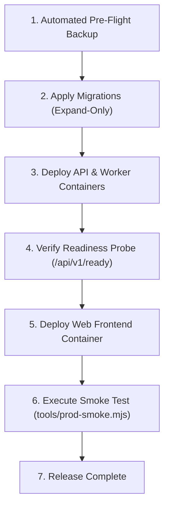

# Aptiva — Production Operations Runbook

**Version**: 1.0  
**Audience**: On-call engineers, operators, and administrators  
**Scope**: Production & staging operations, deployments, database migrations, rollbacks, and incident mitigation.

---

## 1. Routine Deployment Workflow

Every production release follows a strict zero-downtime, expand-only progression:



### Deployment Commands:

1. **Pre-flight Database Backup**:
   ```bash
   bash tools/db-backup.sh
   ```
2. **Apply Database Migrations**:
   ```bash
   pnpm db:migrate:deploy
   ```
   _Rule_: Migrations in production must always be additive/expand-only (adding tables, nullable columns, or non-blocking indexes with `IF NOT EXISTS`). Never drop columns or rename existing fields in the same release as application code changes.
3. **Deploy Containers**:
   ```bash
   docker compose -f infra/docker-compose.prod.yml up -d --build
   ```
4. **Verify Health & Smoke Test**:
   ```bash
   pnpm smoke
   ```

---

## 2. Emergency Rollback Drill

If a release introduces severe bugs, follow this fast rollback procedure:

### Code-Only Rollback (No Schema Changes):

1. Roll back the Docker container image tag to the previous stable release tag:
   ```bash
   # Re-tag and deploy previous image
   docker compose -f infra/docker-compose.prod.yml up -d --no-build api web worker
   ```
2. Run smoke test:
   ```bash
   pnpm smoke
   ```

### Schema Rollback (Forward-Fix Principle):

- **Never run `prisma migrate reset` in production.**
- If a migration was applied with an issue, write a **forward migration** (e.g., dropping the new unused index or reverting a constraint) and apply it via `pnpm db:migrate:deploy`.
- If database data corruption occurred, restore from the pre-flight backup using the disaster recovery procedure below.

---

## 3. Disaster Recovery & Database Restoration

In the event of catastrophic data corruption or host failure:

1. **Locate Latest Verified Dump**:
   ```bash
   ls -lh backups/aptiva_backup_*.dump
   ```
2. **Verify Checksum**:
   ```bash
   sha256sum -c backups/aptiva_backup_<timestamp>.dump.sha256
   ```
3. **Execute Restore**:
   ```bash
   bash tools/db-restore.sh backups/aptiva_backup_<timestamp>.dump "$DATABASE_URL"
   ```
4. **Restart Services & Reconcile Streams**:
   ```bash
   docker compose -f infra/docker-compose.prod.yml restart api worker web
   ```
5. **Verify Stack**:
   ```bash
   pnpm smoke
   ```

---

## 4. First Admin Creation & Elevation

To securely create or promote an administrative account without exposing credentials in scripts or git:

```bash
ADMIN_EMAIL="admin@aptiva.app" ADMIN_PASSWORD="<minimum-16-char-strong-password>" pnpm run create-admin
```

- The script hashes the password with Argon2id, assigns `role='admin'`, sets `emailVerifiedAt=now()`, and records an entry in `audit_logs`.
- Immediately clear the terminal history or unset the environment variables:
  ```bash
  unset ADMIN_EMAIL ADMIN_PASSWORD
  ```

---

## 5. Placement Season Scaling Runbook

During campus hiring season spikes (hundreds of students testing simultaneously):

1. **Pre-warm Connection Pools & Redis**:
   - Ensure PostgreSQL connection pool limit is set to at least 100 connections.
   - Verify Redis memory headroom (`redis-cli info memory`).
2. **Scale Worker Instances**:
   - The stream consumer worker can run with concurrency $> 1$ or multiple worker container instances:
     ```bash
     docker compose -f infra/docker-compose.prod.yml up -d --scale worker=2
     ```
3. **Monitor Stream Consumer Lag**:
   ```bash
   # Check pending unread items in the attempt stream
   redis-cli xlen aptiva:attempts
   redis-cli xpending aptiva:attempts attempt-writers
   ```
